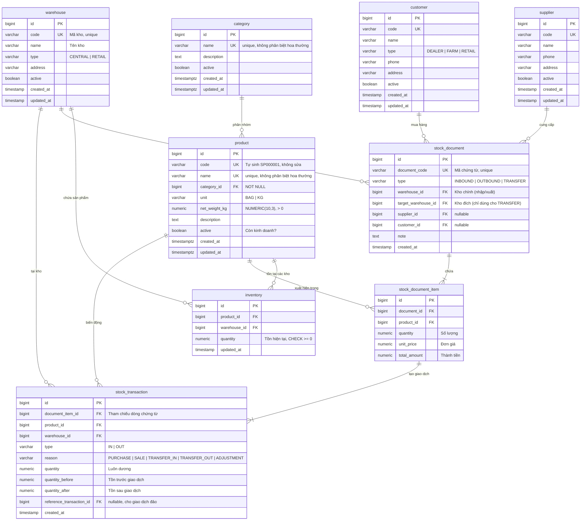

# Thiết kế Database

> ⚠️ **Tài liệu thiết kế.** Chỉ các bảng đánh dấu ✅ là schema đã duyệt; còn lại là ứng viên, cần được xem xét và phê duyệt trước khi tạo migration.

## Các thực thể

| Thực thể | Vai trò | Trạng thái |
|---|---|---|
| `category` | Danh mục sản phẩm (cám gà, cám heo...) | ✅ Đã duyệt 2026-10-14 (V2) |
| `product` | Sản phẩm cám | ✅ Đã duyệt 2026-10-14 (V2) |
| `warehouse` | Kho hàng | Ứng viên |
| `supplier` | Nhà cung cấp | Ứng viên |
| `customer` | Khách hàng (đại lý, trang trại) | Ứng viên |
| `inventory` | Tồn kho hiện tại (product × warehouse) | Ứng viên |
| `stock_document` | Chứng từ kho (phiếu nhập, phiếu xuất, phiếu điều chuyển) | Ứng viên |
| `stock_document_item` | Dòng chi tiết trong chứng từ | Ứng viên |
| `stock_transaction` | Lịch sử biến động tồn kho (bất biến) | Ứng viên |

## ER Diagram (ứng viên)



## Giải thích thiết kế

### category & product (✅ đã duyệt — migration V2)

- `id`: `BIGINT GENERATED ALWAYS AS IDENTITY` (chuẩn SQL, cấm chèn ID thủ công).
- `product.code`: `DEFAULT 'SP' || lpad(nextval('product_code_seq')::text, 6, '0')`. Sequence an toàn khi nhiều request đồng thời (khác `MAX(code)+1` bị trùng khi đồng thời). Rollback có thể làm nhảy số — chấp nhận.
- Vì mã tự sinh không chặn được trùng lặp, dùng `UNIQUE INDEX (lower(name))` để chặn tạo trùng sản phẩm.
- `unit`: `CHECK (unit IN ('BAG','KG'))` — danh sách ít đổi, không cần bảng riêng.
- `net_weight_kg NUMERIC(10,3) CHECK > 0` — phục vụ báo cáo quy đổi tấn.
- `category_id NOT NULL` + FK; index `idx_product_category` cho lọc theo danh mục.
- Thời gian dùng `TIMESTAMPTZ` để không lệch khi server chạy UTC.

### inventory (Tồn kho)

- Mỗi bản ghi là cặp **(product_id, warehouse_id)**, có UNIQUE constraint.
- `quantity` có **CHECK constraint `quantity >= 0`** ở database level.
- Đây là **snapshot** tồn hiện tại, được cập nhật mỗi khi có giao dịch.
- Có thể đối chiếu với tổng StockTransaction để phát hiện sai lệch.

### stock_document (Chứng từ)

- Phiếu nhập, xuất, điều chuyển đều dùng chung bảng, phân biệt bằng `type`.
- `warehouse_id`: kho chính (kho nhập, kho xuất, hoặc kho nguồn cho điều chuyển).
- `target_warehouse_id`: chỉ có giá trị khi `type = TRANSFER`.
- Chứng từ đã tạo không được sửa nội dung (chỉ có thể tạo chứng từ đảo).

### stock_document_item (Dòng chứng từ)

- Mỗi chứng từ có thể có nhiều dòng (nhiều sản phẩm).
- `total_amount = quantity × unit_price` — được tính và lưu để tránh sai lệch do làm tròn.

### stock_transaction (Giao dịch kho — BẤT BIẾN)

- Mỗi bản ghi ghi lại **một biến động** tồn kho tại **một kho** cho **một sản phẩm**.
- `type`: IN (tăng tồn) hoặc OUT (giảm tồn).
- `reason`: lý do cụ thể (PURCHASE, SALE, TRANSFER_IN, TRANSFER_OUT, ADJUSTMENT).
- `quantity`: luôn dương, ý nghĩa tăng/giảm xác định bởi `type`.
- `quantity_before` và `quantity_after`: ghi snapshot tồn tại thời điểm giao dịch, hỗ trợ đối chiếu.
- `reference_transaction_id`: dùng cho giao dịch đảo, trỏ đến giao dịch gốc.
- **Không UPDATE, không DELETE** bản ghi này trong nghiệp vụ thông thường.

Ví dụ: Một phiếu điều chuyển 100 bao cám A từ kho K1 sang kho K2 tạo:
1. StockTransaction: product=A, warehouse=K1, type=OUT, reason=TRANSFER_OUT, quantity=100
2. StockTransaction: product=A, warehouse=K2, type=IN, reason=TRANSFER_IN, quantity=100

## Kiểu dữ liệu cho tiền và số lượng

| Trường | PostgreSQL | Java | Ghi chú |
|---|---|---|---|
| Giá tiền | `NUMERIC(15,2)` | `BigDecimal` | ❓ Cần xác nhận precision |
| Số lượng | `NUMERIC(12,3)` | `BigDecimal` | ❓ Cần xác nhận có cần thập phân không |
| Thành tiền | `NUMERIC(18,2)` | `BigDecimal` | ❓ Cần xác nhận |

> ❓ **Quyết định mở:** Precision và scale cụ thể cần được xác nhận dựa trên nghiệp vụ thực tế.

## Chiến lược cập nhật tồn

**Phương án chọn: Snapshot + Transaction Log**

```
inventory.quantity = giá trị hiện tại (đọc nhanh)
stock_transaction   = lịch sử đầy đủ (kiểm tra, đối chiếu)
```

Khi cập nhật tồn:
1. Lock dòng inventory (SELECT ... FOR UPDATE hoặc UPDATE với WHERE quantity >= :amount)
2. Cập nhật `inventory.quantity`
3. Insert `stock_transaction` với `quantity_before` và `quantity_after`
4. Tất cả trong cùng một transaction

**Tại sao không chỉ dùng transaction log?**
- Tính tổng từ hàng triệu bản ghi sẽ chậm khi dữ liệu lớn
- Snapshot cho phép đọc tồn hiện tại trong O(1)

**Đánh đổi:**
- Cần giữ snapshot nhất quán với transaction log
- Có thể xây chức năng kiểm tra nhất quán (so sánh `inventory.quantity` với `SUM` từ `stock_transaction`)

## Xử lý đồng thời

### Ngăn tồn âm

```sql
-- Cách 1: Conditional update (ưu tiên)
UPDATE inventory
SET quantity = quantity - :amount, updated_at = NOW()
WHERE product_id = :productId
  AND warehouse_id = :warehouseId
  AND quantity >= :amount;
-- Nếu affected rows = 0 → không đủ tồn, throw exception

-- Cách 2: SELECT FOR UPDATE + CHECK constraint (backup)
-- Lock dòng trước, kiểm tra, cập nhật
-- CHECK constraint là tuyến phòng thủ cuối cùng
```

### Deadlock khi điều chuyển

Khi 2 điều chuyển đồng thời: K1→K2 và K2→K1 có thể deadlock.

**Giải pháp: Lock ordering** — luôn lock kho có ID nhỏ hơn trước.

```
Transfer K1→K2: lock K1 trước, rồi K2
Transfer K2→K1: lock K1 trước (ID nhỏ hơn), rồi K2
```

Cả hai transaction đều lock theo thứ tự ID tăng dần → không deadlock.

## Index dự kiến

| Index | Bảng | Cột | Phục vụ truy vấn |
|---|---|---|---|
| UK | `inventory` | `(product_id, warehouse_id)` | Tìm tồn theo sản phẩm + kho |
| UK | `product` | `code` | Tìm sản phẩm theo mã |
| UK | `warehouse` | `code` | Tìm kho theo mã |
| UK | `stock_document` | `document_code` | Tìm chứng từ theo mã |
| IDX | `stock_transaction` | `(product_id, warehouse_id, created_at)` | Lịch sử tồn theo sản phẩm + kho + thời gian |
| IDX | `stock_transaction` | `document_item_id` | Tìm giao dịch theo dòng chứng từ |
| IDX | `stock_document` | `type, created_at` | Lọc chứng từ theo loại + thời gian |

> ⚠️ Index dự kiến, cần kiểm chứng bằng EXPLAIN ANALYZE với dữ liệu thực tế trước khi chốt.

## Quyết định còn mở

- ❓ Precision cho tiền (NUMERIC(15,2) hay (15,4)?)
- ❓ Số lượng có cần thập phân không?
- ❓ Quy tắc làm tròn thành tiền?
- ❓ Cần quản lý lô hàng (batch) không?
- ❓ Chứng từ có cần trạng thái (DRAFT → CONFIRMED) hay tạo là xong?
- ❓ Mã chứng từ tự sinh hay người dùng nhập?
- ✅ ~~Cần bảng `category` riêng?~~ → Có (BR-CAT-01)
- ✅ ~~Cần bảng `unit_of_measure` riêng?~~ → Không; `unit` là chuỗi có CHECK, kèm `net_weight_kg` (BR-PRD-05, 06)
