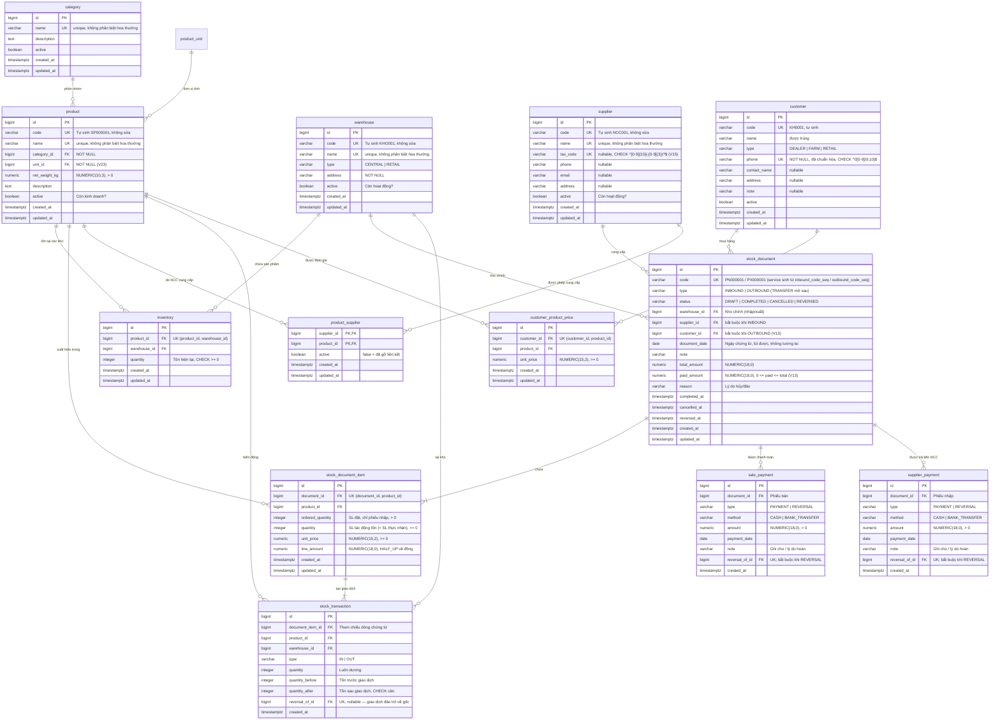

# Thiết kế Database

> ⚠️ **Tài liệu thiết kế.** Chỉ các bảng đánh dấu ✅ là schema đã duyệt; còn lại là ứng viên, cần được xem xét và phê duyệt trước khi tạo migration.

## Các thực thể

| Thực thể | Vai trò | Trạng thái |
|---|---|---|
| `category` | Danh mục sản phẩm (cám gà, cám heo...) | ✅ Đã duyệt 2026-10-14 (V2) |
| `product` | Sản phẩm cám | ✅ Đã duyệt 2026-10-14 (V2); V23 (2026-10-28) `unit` → `unit_id` FK |
| `product_unit` | Đơn vị tính do người dùng quản lý (Bao, Kg, Túi…) | ✅ Đã duyệt 2026-10-28 (V23) |
| `warehouse` | Kho hàng | ✅ Đã duyệt 2026-10-16 (V3) |
| `supplier` | Nhà cung cấp | ✅ Đã duyệt 2026-10-16 (V4) |
| `product_supplier` | NCC được phép cung cấp SP nào (nhiều–nhiều) | ✅ Đã duyệt 2026-10-16 (V4) |
| `customer` | Khách hàng (đại lý, trang trại, khách lẻ) | ✅ Đã duyệt 2026-10-20 (V8) |
| `employee` | Nhân viên + đơn giá lương ngày / tấn bốc xuống / tấn giao hàng | ✅ Đã duyệt 2026-10-20 (V9); V17 (2026-10-26) tách đơn giá tấn thành hai loại |
| `attendance` | Chấm công: nhân viên × ngày (trạng thái ngày + tấn bốc xuống + tấn giao hàng) | ✅ Đã duyệt 2026-10-20 (V11); V17 thêm `delivery_tons` |
| `payroll`, `payroll_item` | Bảng lương tháng đã chốt (bản chụp đơn giá) | ✅ Đã duyệt 2026-10-20 (V12); V17 tách phần tấn thành bốc xuống / giao hàng |

**Migration V17 (2026-10-26) — tách hai loại tấn.** Đổi tên (`RENAME`) cột cũ sang "bốc xuống" và thêm cột "giao hàng":

| Bảng | Cột cũ → cột mới | Cột thêm |
|---|---|---|
| `employee` | `ton_rate` → `unload_ton_rate` | `delivery_ton_rate NUMERIC(15,2)` nullable |
| `attendance` | `tons` → `unload_tons` | `delivery_tons NUMERIC(8,3) NOT NULL DEFAULT 0` |
| `payroll_item` | `tons` → `unload_tons`, `ton_rate` → `unload_ton_rate`, `ton_amount` → `unload_amount` | `delivery_tons`, `delivery_ton_rate`, `delivery_amount` (không có DEFAULT: dòng lương mới phải ghi rõ cả hai phần) |

Ràng buộc đổi: `ck_employee_has_rate` (ít nhất một trong ba đơn giá), `ck_employee_rates`, `ck_attendance_tons`, `ck_attendance_absent_no_tons` (ngày nghỉ: cả hai loại tấn = 0), `ck_payroll_item_quantities`, `ck_payroll_item_amounts`, `ck_payroll_item_total` (`total = day + unload + delivery`). Dùng `RENAME` vì tấn cũ đã được xác nhận là tấn bốc xuống, nên ý nghĩa dữ liệu giữ nguyên; các bảng lương đã chốt giữ nguyên số tiền (phần giao hàng = 0, đơn giá = NULL). Đã kiểm chứng trên database tạm với dữ liệu kiểu cũ.
| `inventory` | Tồn kho hiện tại (product × warehouse) | ✅ Đã duyệt 2026-10-19 (V6) |
| `stock_document` | Chứng từ kho (phiếu nhập, phiếu bán/xuất, phiếu điều chuyển) | ✅ Đã duyệt 2026-10-19 (V6) — `INBOUND`; V13 (2026-10-20) mở `OUTBOUND` + `customer_id`, `paid_amount` |
| `stock_document_item` | Dòng chi tiết trong chứng từ | ✅ Đã duyệt 2026-10-19 (V6) |
| `stock_transaction` | Lịch sử biến động tồn kho (bất biến) | ✅ Đã duyệt 2026-10-19 (V6) |
| `customer_product_price` | Giá bán riêng hiện hành theo (khách, SP) — chỉ để điền sẵn | ✅ Đã duyệt 2026-10-20 (V13) |
| `sale_payment` | Lịch sử thanh toán của phiếu bán (bất biến) | ✅ Đã duyệt 2026-10-20 (V13) |
| `supplier_payment` | Lịch sử trả tiền NCC trên phiếu nhập (bất biến) | ✅ Đã duyệt 2026-10-25 (V16) |
| `cash_book`, `cash_book_change`, `cash_category`, `cash_voucher` + VIEW `cash_flow_entry` | Sổ quỹ: đầu kỳ (1 dòng) + lịch sử sửa, danh mục thu/chi, phiếu thu/chi khác (bất biến); VIEW gộp mọi biến động tiền | ✅ Đã duyệt 2026-10-26 (V19) |
| `employee_advance`, `payroll_payment` | Nhật ký tạm ứng nhân viên và nhật ký trả lương theo dòng lương (bất biến) | ✅ Đã duyệt 2026-10-26 (V18) |
| `app_user`, `app_user_role` | Tài khoản đăng nhập (mật khẩu băm BCrypt) + vai trò, một người nhiều vai trò | ✅ Đã duyệt 2026-10-20 (V14, ADR-0003) |
| `refresh_token` | Refresh token đã phát — chỉ lưu SHA-256; rotation theo family, thu hồi được (KHÔNG bất biến) | ✅ Đã duyệt 2026-10-20 (V14, ADR-0003) |

> **Mã tự sinh (từ V10):** mọi cột `code` dùng `DEFAULT format_code('<tiền tố>', nextval('<seq>'), <độ rộng>)` — đệm số 0 khi ngắn hơn, giữ nguyên khi dài hơn (`KHO1050`). Không dùng `lpad` trực tiếp: `lpad` **cắt** chuỗi dài hơn độ rộng (`lpad('1050', 3)` = `'105'`) → mã trùng. Bảng mới có mã tự sinh phải dùng `format_code` (test `CodeGenerationPersistenceTest` kiểm mọi cột).

## ER Diagram (ứng viên)



## Giải thích thiết kế

### category & product (✅ đã duyệt — migration V2)

- `id`: `BIGINT GENERATED ALWAYS AS IDENTITY` (chuẩn SQL, cấm chèn ID thủ công).
- `product.code`: `DEFAULT 'SP' || lpad(nextval('product_code_seq')::text, 6, '0')`. Sequence an toàn khi nhiều request đồng thời (khác `MAX(code)+1` bị trùng khi đồng thời). Rollback có thể làm nhảy số — chấp nhận.
- Vì mã tự sinh không chặn được trùng lặp, dùng `UNIQUE INDEX (lower(name))` để chặn tạo trùng sản phẩm.
- ~~`unit`: `CHECK (unit IN ('BAG','KG'))`~~ — thay bằng `unit_id` FK tới `product_unit` từ V23 (xem mục dưới).
- `net_weight_kg NUMERIC(10,3) CHECK > 0` — phục vụ báo cáo quy đổi tấn.
- `category_id NOT NULL` + FK; index `idx_product_category` cho lọc theo danh mục.
- Thời gian dùng `TIMESTAMPTZ` để không lệch khi server chạy UTC.

### product_unit (✅ đã duyệt 2026-10-28 — migration V23)

- Người dùng cần thêm túi, thùng… nên đơn vị chuyển từ chuỗi có CHECK sang bảng danh mục, cùng kiểu với `category`: `name VARCHAR(50)`, `active`, `UNIQUE INDEX (lower(name))`. Mỗi SP vẫn **một** đơn vị, không quy đổi (BR-PRD-05).
- `fixed_net_weight_kg NUMERIC(10,3)` nullable, `CHECK > 0`: thay luật cứng "KG thì = 1" bằng luật chung — có giá trị thì `product.net_weight_kg` phải bằng nó (kiểm trong service). Chỉ dòng **Kg = 1** có giá trị; API không nhận field này.
- Migration chuyển dữ liệu: seed `Bao` (NULL) và `Kg` (1), `UPDATE product SET unit_id` theo `BAG → Bao`, `KG → Kg`, rồi `SET NOT NULL`, thêm FK `fk_product_unit`, bỏ `ck_product_unit` và cột `unit`.
- Không index `unit_id`: chưa có màn lọc SP theo đơn vị.
- JPA: `Product.unit` là `@ManyToOne(fetch = EAGER)` (khác `category` LAZY) vì tên đơn vị có trong gần như mọi response chứng từ / tồn kho; ít dòng nên mỗi request chỉ thêm vài SELECT nhỏ, được cache trong persistence context.
- **Phương án chưa làm:** một SP nhiều đơn vị kèm hệ số quy đổi (nhập thùng, bán túi) — phải đổi logic tồn và chứng từ; chỉ làm khi có nhu cầu thật.

### warehouse (✅ đã duyệt — migration V3)

- `code`: `DEFAULT 'KHO' || lpad(nextval('warehouse_code_seq')::text, 3, '0')` — cùng cách sinh mã như `product`. Vượt 999 kho thì `lpad` không cắt số, mã thành `KHO1000` (vẫn unique).
- `UNIQUE INDEX (lower(name))` chặn trùng tên (BR-WH-03).
- `type`: `CHECK (type IN ('CENTRAL','RETAIL'))`.
- `address NOT NULL` (BR-WH-01).
- Không xóa cứng (BR-WH-04): sau này `inventory`, `stock_document`, `stock_transaction` sẽ có FK tới kho.

### supplier & product_supplier (✅ đã duyệt — migration V4)

- `supplier.code`: `DEFAULT 'NCC' || lpad(nextval('supplier_code_seq')::text, 3, '0')` — cùng cách sinh mã như `warehouse`.
- `UNIQUE INDEX (lower(name))` chặn trùng tên (BR-SUP-03). `tax_code`, `phone`, `email`, `address` nullable (BR-SUP-01). `tax_code` (V15, thay `contact_name` đã xóa): `CHECK` định dạng 10 số / 10-3 số và `UNIQUE INDEX ... WHERE tax_code IS NOT NULL` — có nhập thì không trùng, nhiều NCC để trống vẫn hợp lệ (BR-SUP-09). Định dạng email kiểm tra ở API, không ở DB.
- `product_supplier` dùng **khóa chính kép** `(supplier_id, product_id)` thay vì cột `id` riêng: mỗi cặp chỉ có một dòng, gỡ/gán lại chỉ đổi `active` (BR-SUP-05). Phương án thay thế `id` + `UNIQUE(supplier_id, product_id)` chỉ cần khi dòng nối có vòng đời riêng hoặc bảng khác trỏ tới nó.
- `idx_product_supplier_product (product_id)`: khóa chính chỉ phục vụ truy vấn bắt đầu bằng `supplier_id`; index này phục vụ chiều ngược "SP Y do những NCC nào cung cấp".

### Tìm kiếm không dấu (✅ đã duyệt 2026-10-19 — migration V5)

- `CREATE EXTENSION unaccent` + hàm `immutable_unaccent(text)`: bỏ dấu tiếng Việt, xử lý thêm `đ`/`Đ` bằng `replace`. Dùng bởi `CommonSpecifications.keywordContains`: `lower(immutable_unaccent(cột)) LIKE lower(immutable_unaccent(:pattern))`.
- Bọc thành `IMMUTABLE` vì `unaccent()` gốc chỉ `STABLE` → không đánh index được. Hiện **chưa có index** (dữ liệu nhỏ, quét bảng đủ nhanh). Khi một bảng lên hàng chục nghìn dòng: thêm `pg_trgm` + `GIN (lower(immutable_unaccent(name)) gin_trgm_ops)` — `LIKE '%...%'` không dùng được B-tree.
- Triển khai: user chạy migration cần quyền tạo extension (image `postgres` chính thức đã có gói contrib).

### product.min_stock_quantity (✅ đã duyệt 2026-10-19 — migration V7)

- `INTEGER NULL` + `CHECK ck_product_min_stock (min_stock_quantity >= 0)`. NULL = không cảnh báo Sắp hết (BR-STK-03).
- Một mức cho mỗi SP, so với tổng tồn mọi kho. Phương án bị loại: mỗi cặp (SP, kho) một mức đặt ở `inventory`. Cách đó chính xác hơn khi mỗi kho bán một lượng khác nhau, nhưng cần màn hình đặt mức theo kho và phải tạo sẵn dòng tồn = 0.
- Truy vấn tồn theo SP **không cần index mới**: `uk_inventory_product_warehouse` có `product_id` đứng đầu, phục vụ cả `SUM … WHERE product_id IN (…) GROUP BY product_id` lẫn subquery lọc tình trạng. "Đang về" đọc `stock_document_item` theo `product_id` và hiện chưa có index cho cột này (dữ liệu nhỏ); kiểm chứng bằng EXPLAIN ANALYZE ở Tuần 3.

### inventory (Tồn kho) (✅ đã duyệt — migration V6)

- Mỗi bản ghi là cặp **(product_id, warehouse_id)**, `UNIQUE uk_inventory_product_warehouse`.
- `quantity INTEGER` (BR-INV-07) với **`CHECK ck_inventory_quantity_non_negative (quantity >= 0)`** ở DB (BR-INV-03).
- Là **snapshot** tồn hiện tại. JPA chỉ đọc (`@Immutable`); thay đổi duy nhất qua `InventoryRepository`:
  cộng bằng `INSERT … ON CONFLICT DO UPDATE … RETURNING`, trừ bằng `UPDATE … WHERE quantity >= :q RETURNING`.
- Đối chiếu được với `stock_transaction` (`quantity_after` của giao dịch mới nhất = tồn hiện tại).

### stock_document (Chứng từ) (✅ đã duyệt — migration V6)

- Dùng chung cho phiếu nhập / xuất / điều chuyển, phân biệt bằng `type`. V6 mở `INBOUND`; **V13 mở `OUTBOUND`** và thêm `customer_id`, `paid_amount`; **V20 mở `OPENING_STOCK`** (tồn đầu kỳ) và thêm `created_by`, `completed_by`; **V21** công nợ đầu kỳ (không kho); **V22 `STOCK_COUNT`** (kiểm kê). Điều chuyển sẽ nới CHECK và thêm `target_warehouse_id` sau (tiền tố mã nên khác `PC` — `PC` đã là phiếu chi của sổ quỹ).
- `ck_stock_document_customer` (V13): phiếu nhập không có khách; phiếu bán bắt buộc có khách, không có NCC (BR-SAL-01).
- `tracks_debt` (V16, `BOOLEAN NOT NULL DEFAULT TRUE`): phiếu có phát sinh công nợ hay không. Migration V16 đặt `FALSE` cho phiếu nhập đã `COMPLETED`/`REVERSED` trước module công nợ NCC (BR-SPAY-05). Chỉ migration đổi cột này; còn nợ của phiếu `tracks_debt = FALSE` luôn là 0.
- `paid_amount` (V13, dùng chung từ V16): phiếu bán = tổng đã thu — **snapshot** của `sale_payment`; phiếu nhập = tổng đã trả NCC — snapshot của `supplier_payment`, giống `inventory` ↔ `stock_transaction`. `ck_stock_document_paid`: `0 <= paid_amount <= total_amount` (BR-SAL-11). Chỉ đổi khi thu/hoàn tiền, sau khi khóa phiếu `FOR UPDATE`. Còn nợ = `total_amount − paid_amount` (không lưu).
- `code`: **không** có DEFAULT ở DB (khác `product`/`supplier`) vì các loại phiếu khác tiền tố (`PN`, `PX`, `PC`). Service gọi `nextval('inbound_code_seq')` rồi format `PN%06d`.
- `status`: `DRAFT → COMPLETED`, `DRAFT → CANCELLED`, `COMPLETED → REVERSED` (BR-IMP-11, 12). CHECK đảm bảo mốc thời gian đi kèm trạng thái (`completed_at` khi COMPLETED/REVERSED, `cancelled_at`, `reversed_at`).
- `ck_stock_document_supplier`: phiếu nhập bắt buộc có NCC.
- `document_date DATE`: ngày chứng từ (lùi được); thời điểm ghi sổ thật là `completed_at`.
- `total_amount NUMERIC(18,0)` = tổng `line_amount`, tính lại mỗi lần lưu.
- Nội dung chỉ đổi khi `DRAFT`, luôn sau khi khóa dòng phiếu `SELECT … FOR UPDATE` (BR-IMP-14). Không xóa ở mọi trạng thái (BR-IMP-13).

### stock_document_item (Dòng chứng từ) (✅ đã duyệt — migration V6)

- `UNIQUE (document_id, product_id)`: mỗi SP một dòng (BR-IMP-A05); index này cũng phục vụ "các dòng của phiếu X".
- `ordered_quantity` (SL đặt, chỉ phiếu nhập, nullable cho loại khác) và `quantity` (SL tác động tồn = SL thực nhận, ≥ 0) — BR-IMP-03.
- `line_amount = quantity × unit_price`, làm tròn `HALF_UP` về đồng (BR-MON-05) — tính trong Java (`StockDocumentItem.lineAmount`) và lưu lại.
- Sửa phiếu nháp cập nhật dòng **tại chỗ theo `product_id`** (không xóa-hết-thêm-lại): giữ id dòng, không phụ thuộc thứ tự Hibernate xếp DELETE/INSERT khi flush (INSERT chạy trước thì xóa rồi thêm lại cùng SP sẽ vi phạm UNIQUE).

### stock_transaction (Giao dịch kho — BẤT BIẾN) (✅ đã duyệt — migration V6)

- Mỗi bản ghi là **một biến động** tồn của **một SP** tại **một kho**, trỏ về dòng chứng từ sinh ra nó.
- `type`: IN / OUT; `quantity` luôn > 0.
- `quantity_before`, `quantity_after` + **`CHECK ck_stock_transaction_balance`**: IN thì after = before + qty, OUT thì after = before − qty.
- `reversal_of_id` (FK tự tham chiếu, **UNIQUE**): giao dịch đảo trỏ về giao dịch gốc; mỗi giao dịch chỉ bị đảo một lần (BR-INV-06, BR-IMP-12).
- **Chặn sửa/xóa ở DB**: trigger `trg_stock_transaction_immutable` (BEFORE UPDATE OR DELETE, FOR EACH ROW) và `trg_stock_transaction_no_truncate` (BEFORE TRUNCATE) → `RAISE EXCEPTION … ERRCODE restrict_violation`. Phía Java thêm `@Immutable`, không setter.
- So với thiết kế ứng viên: **bỏ cột `reason`** (PURCHASE/SALE...) — loại nghiệp vụ suy ra từ `stock_document.type` qua dòng chứng từ; đổi tên `reference_transaction_id` → `reversal_of_id` cho rõ nghĩa.

### customer_product_price (Bảng giá riêng theo khách) (✅ đã duyệt — migration V13)

- Một giá **hiện hành** cho mỗi cặp (khách, SP), `UNIQUE (customer_id, product_id)` — index này cũng phục vụ "bảng giá của khách X".
- Chỉ để **điền sẵn** giá khi lập phiếu (BR-SAL-07). Giá thực bán chụp trên `stock_document_item.unit_price` → không cần lịch sử giá ở đây. Khi nào cần "giá áp dụng từ ngày X" mới thêm `effective_from`.
- Ghi bằng `INSERT … ON CONFLICT DO UPDATE` (một câu SQL) — hai người cùng đặt giá lần đầu không lỗi trùng UNIQUE. Xóa giá = xóa cứng dòng (không phải lịch sử).

### sale_payment (Thanh toán phiếu bán — BẤT BIẾN) (✅ đã duyệt — migration V13)

- Mỗi dòng là một khoản thu (`PAYMENT`) hoặc một lần hoàn khoản thu (`REVERSAL`) của **một** phiếu bán. `amount > 0`, chiều nằm ở `type`.
- Thu kết hợp tiền mặt + chuyển khoản = **hai dòng** cùng transaction, mỗi dòng một `method` (BR-SAL-12).
- `reversal_of_id` UNIQUE + `ck_sale_payment_reversal` (REVERSAL ⇔ có `reversal_of_id`): mỗi khoản hoàn đúng một lần.
- Trigger `trg_sale_payment_immutable` / `trg_sale_payment_no_truncate` chặn UPDATE/DELETE/TRUNCATE như `stock_transaction`.
- Công nợ khách = `SUM(total_amount − paid_amount)` của phiếu `OUTBOUND` + `COMPLETED` còn nợ, `GROUP BY customer_id` — không có bảng số dư.

### Tồn kho đầu kỳ: stock_document type OPENING_STOCK (✅ đã duyệt 2026-10-27 — migration V20)

- **Không thêm bảng.** Phiếu tồn đầu kỳ là `stock_document` với `type = 'OPENING_STOCK'`, dòng ở `stock_document_item` (`ordered_quantity` NULL), xác nhận đi qua `InventoryService.stockIn` như phiếu nhập → `inventory` + `stock_transaction` IN; đảo dùng lại `InventoryService.reverse`. Mọi truy vấn phiếu nhập / bán / hàng đang về / công nợ đều lọc cứng theo `type` nên không bị lẫn.
- **Vì sao không bảng riêng:** `stock_transaction.document_item_id` là `NOT NULL` — mọi biến động phải trỏ về một dòng chứng từ. Bảng riêng thì hoặc nới cột đó thành nullable, hoặc nhân bản cơ chế tồn (bất biến, đảo, khóa, lịch sử). Cả hai đều yếu hơn thêm một giá trị `type`.
- `ck_stock_document_opening_stock`: phiếu đầu kỳ không có `supplier_id`, `customer_id` và `tracks_debt = FALSE` (BR-OPN-08). Entity đặt `tracksDebt = false` ngay trong constructor cho loại này.
- `created_by`, `completed_by` (`VARCHAR(50)`, nullable): tên đăng nhập người lập / người xác nhận. Thêm cho phiếu đầu kỳ; phiếu nhập/bán cũ để NULL (chưa ghi).
- Mã `DTK` + 6 số từ `opening_stock_code_seq`.
- **Chặn khai trùng (BR-OPN-05), hai lớp:**
  1. Trước khi cộng: `StockTransactionRepository.findProductIdsWithMovement(warehouseId, productIds)` — SP nào đã có giao dịch tại kho, **bỏ** giao dịch thuộc phiếu `OPENING_STOCK` đã `REVERSED` (cả IN gốc lẫn OUT đảo đều gắn dòng của phiếu đó, nên lọc theo trạng thái phiếu là đủ).
  2. Sau khi cộng: `quantity_before` của giao dịch vừa ghi phải bằng 0, nếu không → rollback. Lớp 1 đọc lúc chưa khóa nên hai phiếu chứa cùng SP xác nhận cùng lúc đều lọt qua; câu upsert tồn khóa dòng `inventory`, người đến sau chờ rồi thấy tồn khác 0. Thử bỏ lớp 2: 5/5 phiếu đồng thời đều thành công, tồn bị cộng dồn (test `OpeningStockConcurrencyTest` bắt được).
- Không có UNIQUE ở DB cho cặp (SP, kho) vì điều kiện phụ thuộc lịch sử giao dịch và trạng thái phiếu, không biểu diễn được bằng index trên một bảng.

### Kiểm kê: stock_document type STOCK_COUNT + stock_count_reason (✅ đã duyệt 2026-10-27 — migration V22)

- Phiếu kiểm kê là `stock_document` `type = 'STOCK_COUNT'` (mã `KK`, `stock_count_code_seq`). `ck_stock_document_stock_count`: không NCC, không khách, `tracks_debt = FALSE`. Kho bắt buộc nhờ `ck_stock_document_warehouse` (V21).
- `stock_document.book_snapshot_at`: lúc chụp SL sổ sách; `ck_stock_document_snapshot`: có khi và chỉ khi là phiếu kiểm kê. Cảnh báo "phát sinh sau lúc chụp" = `stock_transaction.created_at > book_snapshot_at` cho các SP trên phiếu.
- `stock_document_item` thêm `book_quantity`, `counted_quantity` (NULL = chưa đếm), `reason_id` (FK `stock_count_reason`), `reason_note`. Cột `quantity` cũ = `|đếm − sổ sách|` — đúng số được cộng/trừ khi xác nhận; `ck_stock_document_item_count` giữ quan hệ này ở DB. Chiều IN/OUT suy từ dấu chênh. Đơn giá / thành tiền = 0.
- `uk_stock_document_open_count (warehouse_id) WHERE type = 'STOCK_COUNT' AND status = 'DRAFT'`: mỗi kho một phiếu đang kiểm — hai phiếu cùng điều chỉnh một SP sẽ trừ/cộng chênh hai lần.
- **Vì sao ghi chênh (delta) chứ không đặt tồn = số đếm:** kho không bị khóa trong lúc kiểm. Đặt tồn tuyệt đối sẽ xóa mất các giao dịch xảy ra giữa lúc đếm và lúc xác nhận. Delta đi qua `InventoryService.stockIn/stockOut` nên vẫn có kiểm tra không âm, có `quantity_before/after`, có đảo. Phương án khóa kho (chặn nhập/bán) đúng tuyệt đối nhưng bắt kho ngừng bán — chỉ đáng làm nếu kiểm toàn kho định kỳ lớn.
- `stock_count_reason`: `UNIQUE (lower(name))`, `active`, 4 dòng mặc định trong migration.

### Công nợ đầu kỳ: stock_document không kho, không dòng hàng (✅ đã duyệt 2026-10-27 — migration V21)

- `type` thêm `OPENING_CUSTOMER_DEBT` (mã `DKH`, `opening_customer_debt_code_seq`) và `OPENING_SUPPLIER_DEBT` (mã `DNC`, `opening_supplier_debt_code_seq`). Cột `type` nới từ `VARCHAR(20)` lên `VARCHAR(30)` (`OPENING_CUSTOMER_DEBT` dài 21 ký tự).
- **Vì sao dùng `stock_document`:** `sale_payment` và `supplier_payment` đều có FK `document_id → stock_document`. Đặt khoản nợ cũ ở đây thì dùng lại được hết: thu/trả kết hợp TM + CK, hoàn khoản ghi nhầm, `ck_stock_document_paid` (không thu vượt), trang công nợ, VIEW sổ quỹ (VIEW join `stock_document` lấy mã chứng từ — khoản thu nợ cũ tự hiện mã `DKH…`). Bảng `opening_debt` riêng thì phải làm lại toàn bộ phần tiền và sửa VIEW — hai cơ chế tiền song song dễ lệch nhau.
- **Đánh đổi:** `warehouse_id` thành nullable. `ck_stock_document_warehouse`: `(type là nợ đầu kỳ) = (warehouse_id IS NULL)` — chứng từ kho vẫn bắt buộc có kho, nợ đầu kỳ bắt buộc không có. Entity `StockDocument.warehouse` bỏ `optional = false`; các truy vấn phiếu nhập / bán / tồn đầu kỳ vẫn lọc theo `type` nên luôn có kho.
- `ck_stock_document_opening_debt`: nợ khách có `customer_id`, không `supplier_id`; nợ NCC ngược lại; cả hai `tracks_debt = TRUE`. `ck_stock_document_opening_debt_amount`: `total_amount > 0`. Tổng tiền đặt trực tiếp (`StockDocument.setOpeningDebtAmount`, chỉ cho hai loại này) vì không có dòng hàng.
- **UNIQUE một phần** `uk_stock_document_opening_customer_debt (customer_id) WHERE type = 'OPENING_CUSTOMER_DEBT' AND status = 'COMPLETED'` (và bản NCC): mỗi khách một khoản còn hiệu lực; khoản `REVERSED` không tính nên nhập lại được. Service kiểm tra trước để báo lỗi rõ tên khách; UNIQUE là chốt chặn khi hai người ghi đồng thời (`saveAllAndFlush` để lỗi nổ trong service → 409).
- Tạo thẳng `COMPLETED` (`completed_at` = lúc ghi nhận) — không có nháp. Truy vấn công nợ `sumOutstandingByCustomer` / `BySupplier` đổi `type = OUTBOUND` / `INBOUND` thành `type IN (…, OPENING_…_DEBT)`.

### Sổ quỹ: VIEW cash_flow_entry + phiếu thu/chi (✅ đã duyệt — migration V19)

- **Không chép tiền sang bảng mới.** `cash_flow_entry` là VIEW `UNION ALL` của `sale_payment` (+), `supplier_payment` (−), `payroll_payment` (−, **bỏ** `ADVANCE_DEDUCTION`), `employee_advance` (−) và `cash_voucher` (phiếu thu +, phiếu chi −). Dòng hoàn đảo dấu. `method` `CASH` → tài khoản `CASH`, `BANK_TRANSFER` → `BANK`. Cột: `source, source_id, account, entry_date, amount` (có dấu)`, reference, counterparty, category, note, is_reversal, reversed, created_at`.
- **Vì sao VIEW:** một nguồn số liệu duy nhất (sổ quỹ không bao giờ lệch chứng từ) và không sửa 4 module đã duyệt. **Đổi sang bảng ghi kèm từng giao dịch** (cùng transaction với thanh toán) khi cần **chặn quỹ âm** hoặc **nhiều tài khoản** — lúc đó phải có số dư lưu riêng để khóa `FOR UPDATE`, VIEW không khóa được.
- Số dư không lưu: số dư tại ngày D = đầu kỳ + `SUM(amount)` các dòng có `entry_date` trong [đầu kỳ, D]. Số dư lũy kế từng dòng dùng `SUM(amount) OVER (ORDER BY entry_date, created_at, source, source_id)` — thứ tự đủ chặt để số dư không nhảy. Đọc bằng `NamedParameterJdbcTemplate` (VIEW không có entity JPA).
- `cash_book`: đúng một dòng (`CHECK id = 1`), số dư đầu kỳ ≥ 0. `cash_book_change`: lịch sử đặt/sửa đầu kỳ, bất biến (trigger).
- `cash_voucher`: mã `PT`/`PC` + 6 số (2 sequence), phiếu hoàn = mã gốc + `-H`; `direction` là chiều của phiếu GỐC (phiếu hoàn giữ nguyên, dấu đảo nhờ `type = REVERSAL`); `reversal_of_id` UNIQUE; trigger chặn UPDATE/DELETE/TRUNCATE (hàm `prevent_cash_change` dùng chung, thông báo nêu tên bảng). `cash_category`: `UNIQUE (lower(name))`, `direction` không đổi sau khi tạo.

### employee_advance, payroll_payment, số dư tạm ứng (Công nợ nhân viên — BẤT BIẾN) (✅ đã duyệt — migration V18)

- **Hai số tổng (snapshot) có CHECK:** `employee.advance_balance NUMERIC(18,0)` với `ck_employee_advance_balance` (≥ 0) và `payroll_item.paid_amount NUMERIC(18,0)` với `ck_payroll_item_paid` (0 ≤ paid ≤ `total_amount`). Chỉ đổi sau khi service khóa dòng nhân viên rồi dòng lương `FOR UPDATE` — CHECK chỉ chặn số **âm**, không chặn **cập nhật bị mất** (hai request cùng đọc 100.000 rồi cùng ghi 40.000), nên khóa là bắt buộc; đã kiểm bằng test đồng thời.
- **`employee_advance`:** khoản ứng (`ADVANCE`) hoặc hoàn khoản ứng ghi nhầm (`REVERSAL`), `method` chỉ `CASH`/`BANK_TRANSFER` (tạm ứng luôn là tiền chi ra). Cấu trúc và ràng buộc như `sale_payment`.
- **`payroll_payment`:** khoản trả lương (`PAYMENT`) hoặc hoàn (`REVERSAL`) gắn với dòng lương bằng **khóa ngoại kép** `(payroll_id, employee_id) → payroll_item`. `method` thêm `ADVANCE_DEDUCTION` (trừ vào tạm ứng — không có tiền ra khỏi quỹ). Hoàn khoản `ADVANCE_DEDUCTION` thì số dư tạm ứng cộng lại.
- **Số dư tạm ứng** = Σ `employee_advance` (ADVANCE − REVERSAL) − Σ `payroll_payment` `ADVANCE_DEDUCTION` (PAYMENT − REVERSAL); test `assertAdvanceBalanceMatchesLedger` kiểm snapshot khớp nhật ký sau mỗi kịch bản.
- **`payroll.tracks_debt`** (`BOOLEAN NOT NULL DEFAULT TRUE`): V18 đặt `FALSE` cho mọi bảng lương `FINALIZED` có trước (BR-EPAY-05). Cờ ở bảng lương (mỗi tháng một bản), không ở từng dòng.
- `PayrollItem` không còn `@Immutable` của Hibernate (nó chặn cập nhật `paid_amount`); các cột bản chụp dùng `updatable = false`.
- Công nợ nhân viên = Σ (`total_amount − paid_amount`) của dòng lương thuộc bảng `FINALIZED` + `tracks_debt` còn nợ, gộp theo nhân viên, cộng với `advance_balance` — không có bảng số dư riêng.

### supplier_payment (Trả tiền NCC — BẤT BIẾN) (✅ đã duyệt — migration V16)

- Cùng cấu trúc và ràng buộc với `sale_payment` (PAYMENT/REVERSAL, hai dòng khi trả kết hợp, `reversal_of_id` UNIQUE, trigger `trg_supplier_payment_immutable` / `trg_supplier_payment_no_truncate`).
- **Bảng riêng, không gộp với `sale_payment`:** chiều tiền (chi/thu) và quyền khác nhau, và không phải sửa module bán hàng đã duyệt. Gộp thành một bảng `document_payment` chỉ đáng làm khi có thêm loại thanh toán thứ ba.
- Công nợ NCC = `SUM(total_amount − paid_amount)` của phiếu `INBOUND` + `COMPLETED` + `tracks_debt` còn nợ, `GROUP BY supplier_id` (index `idx_stock_document_supplier`).

Ví dụ (khi có module điều chuyển): phiếu điều chuyển 100 bao cám A từ kho K1 sang K2 tạo:
1. StockTransaction: product=A, warehouse=K1, type=OUT, quantity=100
2. StockTransaction: product=A, warehouse=K2, type=IN, quantity=100

## Kiểu dữ liệu cho tiền và số lượng (✅ chốt 2026-10-19)

| Trường | PostgreSQL | Java | Quy tắc |
|---|---|---|---|
| Đơn giá | `NUMERIC(15,2)` | `BigDecimal` | VND, tối đa 2 chữ số lẻ (BR-MON-03, 04) |
| Số lượng | `INTEGER` | `int` / `Integer` | Luôn nguyên, với mọi đơn vị (BR-INV-07); JSON `2.5` → 400 (`accept-float-as-int: false`) |
| Thành tiền dòng, tổng phiếu | `NUMERIC(18,0)` | `BigDecimal` | `HALF_UP` về đồng; tổng = cộng các dòng, không làm tròn thêm (BR-MON-05) |

## Chiến lược cập nhật tồn

**Phương án chọn: Snapshot + Transaction Log**

```
inventory.quantity = giá trị hiện tại (đọc nhanh)
stock_transaction   = lịch sử đầy đủ (kiểm tra, đối chiếu)
```

Khi cập nhật tồn:
1. Lock dòng inventory (SELECT ... FOR UPDATE hoặc UPDATE với WHERE quantity >= :amount)
2. Cập nhật `inventory.quantity`
3. Insert `stock_transaction` với `quantity_before` và `quantity_after`
4. Tất cả trong cùng một transaction

**Tại sao không chỉ dùng transaction log?**
- Tính tổng từ hàng triệu bản ghi sẽ chậm khi dữ liệu lớn
- Snapshot cho phép đọc tồn hiện tại trong O(1)

**Đánh đổi:**
- Cần giữ snapshot nhất quán với transaction log
- Có thể xây chức năng kiểm tra nhất quán (so sánh `inventory.quantity` với `SUM` từ `stock_transaction`)

## Xử lý đồng thời

### Ngăn tồn âm

```sql
-- Cách 1: Conditional update (ưu tiên)
UPDATE inventory
SET quantity = quantity - :amount, updated_at = NOW()
WHERE product_id = :productId
  AND warehouse_id = :warehouseId
  AND quantity >= :amount;
-- Nếu affected rows = 0 → không đủ tồn, throw exception

-- Cách 2: SELECT FOR UPDATE + CHECK constraint (backup)
-- Lock dòng trước, kiểm tra, cập nhật
-- CHECK constraint là tuyến phòng thủ cuối cùng
```

### Deadlock khi điều chuyển

Khi 2 điều chuyển đồng thời: K1→K2 và K2→K1 có thể deadlock.

**Giải pháp: Lock ordering** — luôn lock kho có ID nhỏ hơn trước.

```
Transfer K1→K2: lock K1 trước, rồi K2
Transfer K2→K1: lock K1 trước (ID nhỏ hơn), rồi K2
```

Cả hai transaction đều lock theo thứ tự ID tăng dần → không deadlock.

### Đã triển khai ở V6 (phiếu nhập)

| Tình huống | Cơ chế | Test kiểm chứng |
|---|---|---|
| Hai người cùng bấm Hoàn tất / Đảo một phiếu | Khóa dòng `stock_document` bằng `SELECT … FOR UPDATE` (`StockDocumentRepository.findForUpdate`), **rồi** kiểm tra lại trạng thái trong transaction | `InboundReceiptConcurrencyTest`: 5 luồng → đúng 1 thành công. Đã thử bỏ khóa → cả 5 thành công, test fail |
| Hai phiếu cùng nhập SP mới vào cùng kho | `INSERT … ON CONFLICT (product_id, warehouse_id) DO UPDATE` — không lỗi trùng UNIQUE, không mất lần cộng | Chuỗi `quantity_before → after` của 5 giao dịch nối liền |
| Đảo phiếu khi hàng đã xuất bớt | `UPDATE … WHERE quantity >= :q`; 0 dòng → `BusinessException` → rollback mọi dòng đã trừ | Phiếu 2 dòng, dòng 2 thiếu → dòng 1 không bị trừ, không có OUT nào |
| Nhiều dòng cùng phiếu | Xử lý theo `product_id` tăng dần (lock ordering) | — |
| Nhiều phiếu bán cùng trừ một SP (V13) | `UPDATE … WHERE quantity >= :q` | `SalesOrderConcurrencyTest`: 5 phiếu × 30 bao, tồn 100 → đúng 3 thành công, tồn còn 10 |
| Phiếu bán 2 dòng, dòng 2 thiếu tồn | Lỗi → rollback cả dòng 1 đã trừ | Tồn dòng 1 nguyên vẹn, 0 giao dịch, phiếu vẫn `DRAFT` |
| Hai người cùng thu tiền một phiếu | Khóa phiếu `FOR UPDATE` rồi mới so với số còn nợ; CHECK `paid <= total` dự phòng | 5 luồng × 400.000 cho phiếu nợ 1.000.000 → đúng 2 thành công |

## Index dự kiến

| Index | Bảng | Cột | Phục vụ truy vấn |
|---|---|---|---|
| UK | `inventory` | `(product_id, warehouse_id)` | Tìm tồn theo sản phẩm + kho |
| UK | `product` | `code` | Tìm sản phẩm theo mã |
| UK | `warehouse` | `code` | Tìm kho theo mã |
| UK | `stock_document` | `code` | Tìm chứng từ theo mã (V6) |
| UK | `stock_document_item` | `(document_id, product_id)` | Dòng của một phiếu; chặn SP lặp (V6) |
| UK | `stock_transaction` | `reversal_of_id` | Chặn đảo hai lần (V6) |
| IDX | `stock_transaction` | `(product_id, warehouse_id, created_at)` | Lịch sử tồn theo sản phẩm + kho + thời gian (V6) |
| IDX | `stock_transaction` | `document_item_id` | Tìm giao dịch theo dòng chứng từ (V6) |
| IDX | `stock_document` | `(customer_id, document_date)` | Phiếu bán / công nợ theo khách (V13) |
| UK | `customer_product_price` | `(customer_id, product_id)` | Bảng giá của khách; chặn trùng (V13) |
| IDX | `sale_payment` | `document_id` | Lịch sử thanh toán của phiếu (V13) |
| UK | `sale_payment` | `reversal_of_id` | Chặn hoàn hai lần (V13) |
| IDX | `stock_document` | `(type, document_date)` | Lọc chứng từ theo loại + ngày chứng từ (V6 — đổi từ `created_at` vì danh sách lọc theo ngày chứng từ) |

> ⚠️ Index đã tạo nhưng chưa kiểm chứng bằng EXPLAIN ANALYZE với dữ liệu thực tế (việc của Tuần 3).

## Quyết định còn mở

- ✅ ~~Precision cho tiền?~~ → Đơn giá `NUMERIC(15,2)`, thành tiền `NUMERIC(18,0)` (BR-MON-04, 05)
- ✅ ~~Số lượng có cần thập phân không?~~ → Không, `INTEGER` (BR-INV-07)
- ✅ ~~Quy tắc làm tròn thành tiền?~~ → `HALF_UP` về đồng (BR-MON-05)
- ⚠️ Cần quản lý lô hàng (batch) không? → Tạm **không** trong MVP (BR-IMP-A08)
- ✅ ~~Chứng từ có cần trạng thái?~~ → Có: DRAFT / COMPLETED / CANCELLED / REVERSED (BR-IMP-02, 11, 12)
- ✅ ~~Mã chứng từ tự sinh hay người dùng nhập?~~ → Tự sinh `PN000001` (BR-IMP-07)
- ✅ ~~Cần bảng `category` riêng?~~ → Có (BR-CAT-01)
- ✅ ~~Cần bảng `unit_of_measure` riêng?~~ → Ban đầu không (chuỗi có CHECK); **từ V23 (2026-10-28) có** bảng `product_unit` để người dùng tự thêm đơn vị (BR-UNIT-01..04)
