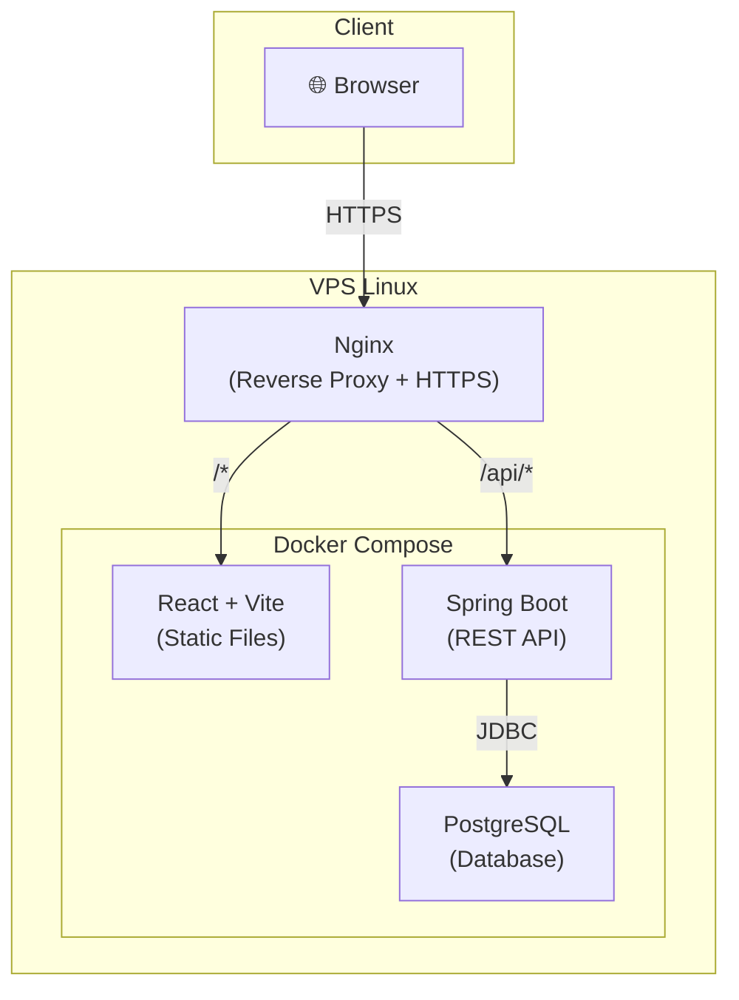
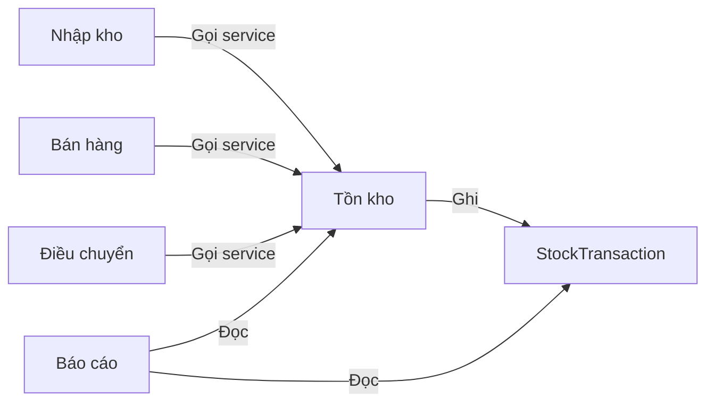

# Kiến trúc hệ thống

## Tổng quan

Hệ thống sử dụng kiến trúc **modular monolith** — một ứng dụng backend duy nhất, phân chia bên trong theo module nghiệp vụ.

### Tại sao modular monolith?

| Tiêu chí | Monolith | Modular Monolith | Microservices |
|---|---|---|---|
| Độ phức tạp triển khai | Thấp | Thấp | Cao |
| Phân chia trách nhiệm | Yếu | Tốt | Rất tốt |
| Transaction xuyên module | Đơn giản | Đơn giản | Phức tạp (saga) |
| Phù hợp Fresher | ✅ | ✅ | ❌ |
| Mở rộng sau này | Khó tách | Dễ tách | Đã tách |

**Kết luận:** Modular monolith giữ sự đơn giản của monolith nhưng có ranh giới module rõ ràng, dễ hiểu và dễ tách ra microservices nếu cần trong tương lai.

## Sơ đồ kiến trúc



## Trách nhiệm các thành phần

### Frontend (React + TypeScript + Vite)

- Giao diện người dùng
- Gọi REST API, hiển thị dữ liệu
- Validation cơ bản phía client (UX, không thay thế server validation)
- Build thành static files, Nginx phục vụ trực tiếp

### Backend (Spring Boot)

- REST API xử lý nghiệp vụ
- Validation đầu vào
- Quản lý transaction
- Business logic và quy tắc tồn kho
- Kết nối database qua Spring Data JPA / JDBC

### Database (PostgreSQL)

- Lưu trữ dữ liệu
- Ràng buộc toàn vẹn (FK, CHECK, UNIQUE)
- CHECK constraint ngăn tồn âm
- Migration quản lý bởi Flyway

### Reverse Proxy (Nginx)

- Điểm vào duy nhất từ Internet
- Phân luồng request: `/api/*` → Backend, `/*` → Frontend
- HTTPS termination
- Không mở cổng PostgreSQL ra ngoài

## Cấu trúc module backend

```
backend/src/main/java/com/grainwarehouse/
├── product/          # Quản lý sản phẩm
│   ├── controller/
│   ├── service/
│   ├── repository/
│   ├── dto/
│   └── entity/
├── warehouse/        # Quản lý kho
├── inventory/        # Tồn kho và giao dịch kho
├── inbound/          # Nhập kho
├── outbound/         # Bán hàng / xuất kho
├── transfer/         # Điều chuyển kho
├── report/           # Báo cáo
└── common/           # Shared: exception handler, base entity, utils
```

Mỗi module có package riêng, giao tiếp qua service interface. Không import trực tiếp entity của module khác nếu không cần thiết.

## Giao tiếp giữa các module



- Các module nhập/xuất/điều chuyển gọi **InventoryService** để cập nhật tồn
- InventoryService chịu trách nhiệm kiểm tra tồn, cập nhật tồn và ghi StockTransaction
- Tất cả trong cùng một database transaction (vì là monolith)
- Report chỉ đọc, không cập nhật

## Ranh giới transaction

| Nghiệp vụ | Phạm vi transaction |
|---|---|
| Nhập kho | Tạo chứng từ + cập nhật tồn + ghi StockTransaction |
| Bán hàng | Tạo chứng từ + kiểm tra tồn + trừ tồn + ghi StockTransaction |
| Điều chuyển | Tạo chứng từ + trừ tồn kho nguồn + tăng tồn kho đích + ghi StockTransaction (2 bản ghi) |

Tất cả các bước trong một nghiệp vụ phải thành công hoặc rollback toàn bộ.

## Các điểm mở rộng sau MVP

- **Authentication/Authorization:** Spring Security + JWT
- **Caching:** Spring Cache (local) hoặc Redis nếu cần
- **Message queue:** Chỉ khi có nghiệp vụ bất đồng bộ rõ ràng
- **Tách service:** Module nào có traffic cao hoặc cần scale riêng mới tách
- **IoT (cân điện tử):** Có thể tạo module riêng nhận dữ liệu, ghi vào cùng database

> ⚠️ Không triển khai bất kỳ mở rộng nào khi chưa có nhu cầu nghiệp vụ và chưa được đồng ý.
