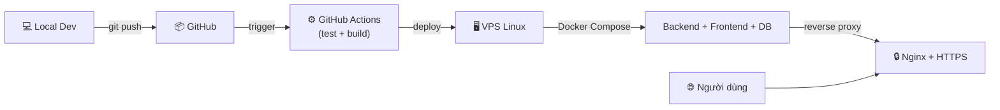

# Hướng dẫn triển khai (Deployment)

## Luồng triển khai tổng quan



## Quản lý biến môi trường

### Nguyên tắc

- **Không commit** `.env`, mật khẩu, token, private key vào Git
- File `.env.example` chỉ chứa tên biến và giá trị mẫu
- Trên VPS, biến môi trường lưu trong file `.env` với quyền đọc hạn chế (`chmod 600`)
- Trong GitHub Actions, dùng **GitHub Secrets** cho các giá trị nhạy cảm

### Phân loại biến

| Biến | Dev | Production | Ghi chú |
|---|---|---|---|
| `POSTGRES_PASSWORD` | postgres | chuỗi ngẫu nhiên mạnh | Không commit |
| `SPRING_PROFILES_ACTIVE` | dev | prod | Ảnh hưởng cấu hình JPA, logging |
| `SERVER_PORT` | 8080 | 8080 | Nginx proxy phía trước |
| `VITE_API_BASE_URL` | http://localhost:8080/api | /api | Build-time variable |

## Bảo mật cơ bản

### PostgreSQL không mở ra Internet

```yaml
# docker-compose.yml — DB chỉ trong internal network
services:
  db:
    # KHÔNG có ports mapping ra host trên prod
    networks:
      - internal

  backend:
    networks:
      - internal
      - web

  nginx:
    ports:
      - "80:80"
      - "443:443"
    networks:
      - web
```

### Firewall trên VPS

```bash
# Chỉ mở port cần thiết
sudo ufw default deny incoming
sudo ufw default allow outgoing
sudo ufw allow ssh          # 22
sudo ufw allow http         # 80
sudo ufw allow https        # 443
sudo ufw enable
```

### SSH

- Dùng SSH key, tắt password authentication
- Không dùng root trực tiếp, tạo user riêng (ví dụ: `deployer`)

## Migration an toàn

### Nguyên tắc

- Flyway migration chạy tự động khi backend khởi động
- **Không sửa** migration đã áp dụng trên production
- Test migration trên môi trường staging/local trước
- Backup database **trước** khi chạy migration mới trên production

### Quy trình

```
1. Viết migration mới (V{n}__description.sql)
2. Test local
3. Backup production database
4. Deploy → Flyway chạy migration tự động
5. Kiểm tra ứng dụng qua health check
6. Nếu lỗi → rollback
```

## CI/CD với GitHub Actions

### Pipeline dự kiến

```
Push to main
  → Checkout code
  → Setup JDK 21 + Node.js
  → Backend: mvn test
  → Frontend: npm test + npm run build
  → Build Docker images
  → (Manual trigger) Deploy to VPS via SSH
```

> ⚠️ Dự án này dùng **Continuous Delivery** — CI tự động chạy test/build, deploy cần manual trigger để kiểm soát rủi ro.
