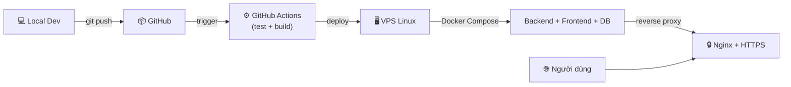

# Hướng dẫn triển khai (Deployment)

## Luồng triển khai tổng quan



## Quản lý biến môi trường

### Nguyên tắc

- **Không commit** `.env`, mật khẩu, token, private key vào Git
- File `.env.example` chỉ chứa tên biến và giá trị mẫu
- Trên VPS, biến môi trường lưu trong file `.env` với quyền đọc hạn chế (`chmod 600`)
- Trong GitHub Actions, dùng **GitHub Secrets** cho các giá trị nhạy cảm

### Phân loại biến

| Biến | Dev | Production | Ghi chú |
|---|---|---|---|
| `POSTGRES_PASSWORD` | postgres | chuỗi ngẫu nhiên mạnh | Không commit |
| `SPRING_PROFILES_ACTIVE` | dev | prod | Ảnh hưởng cấu hình JPA, logging |
| `SERVER_PORT` | 8080 | 8080 | Nginx proxy phía trước |
| `VITE_API_BASE_URL` | http://localhost:8080/api | /api | Build-time variable |

## Bảo mật cơ bản

### PostgreSQL không mở ra Internet

```yaml
# docker-compose.yml — DB chỉ trong internal network
services:
  db:
    # KHÔNG có ports mapping ra host trên prod
    networks:
      - internal

  backend:
    networks:
      - internal
      - web

  nginx:
    ports:
      - "80:80"
      - "443:443"
    networks:
      - web
```

### Firewall trên VPS

```bash
# Chỉ mở port cần thiết
sudo ufw default deny incoming
sudo ufw default allow outgoing
sudo ufw allow ssh          # 22
sudo ufw allow http         # 80
sudo ufw allow https        # 443
sudo ufw enable
```

### SSH

- Dùng SSH key, tắt password authentication
- Không dùng root trực tiếp, tạo user riêng (ví dụ: `deployer`)

## Migration an toàn

### Nguyên tắc

- Flyway migration chạy tự động khi backend khởi động
- **Không sửa** migration đã áp dụng trên production
- Test migration trên môi trường staging/local trước
- Backup database **trước** khi chạy migration mới trên production

### Quy trình

```
1. Viết migration mới (V{n}__description.sql)
2. Test local
3. Backup production database
4. Deploy → Flyway chạy migration tự động
5. Kiểm tra ứng dụng qua health check
6. Nếu lỗi → rollback
```

## CI/CD với GitHub Actions

### Pipeline dự kiến

```
Push to main
  → Checkout code
  → Setup JDK 21 + Node.js
  → Backend: mvn test
  → Frontend: npm test + npm run build
  → Build Docker images
  → (Manual trigger) Deploy to VPS via SSH
```

> ⚠️ Dự án này dùng **Continuous Delivery** — CI tự động chạy test/build, deploy cần manual trigger để kiểm soát rủi ro.

---

## Triển khai thực tế (Docker Compose, đã kiểm chứng local 2026-10-20)

### Thành phần

| File | Vai trò |
|---|---|
| `infra/docker/docker-compose.prod.yml` | 3 container: `db` (Postgres, chỉ mạng nội bộ) → `backend` (Spring Boot, profile `prod`) → `web` (Nginx, cổng 80) |
| `infra/docker/backend.Dockerfile` | Build jar bằng Maven, chạy trên JRE 21 alpine, user không phải root |
| `infra/docker/frontend.Dockerfile` | Build React (Vite) rồi đóng vào image Nginx |
| `infra/nginx/default.conf` | Phục vụ file tĩnh, chuyển `/api/` sang backend, fallback `index.html` cho React Router. **Không** chuyển `/actuator` |
| `backend/src/main/resources/application-prod.yml` | Datasource lấy từ biến môi trường, không có giá trị mặc định |
| `.env.prod.example` | Mẫu biến môi trường production (`.env.prod` bị `.gitignore`) |

Frontend gọi API bằng đường dẫn tương đối `/api/...` → chung tên miền với backend, cookie đăng nhập hoạt động, không cần CORS.

### Bước 0 — Chạy thử trên máy local (Windows + Docker Desktop)

```bash
cp .env.prod.example .env.prod      # điền POSTGRES_PASSWORD, JWT_SECRET, BOOTSTRAP_ADMIN_PASSWORD; HTTP_PORT=8088 nếu cổng 80 bận
docker compose -f infra/docker/docker-compose.prod.yml --env-file .env.prod up -d --build
# Mở http://localhost:8088 — đăng nhập bằng BOOTSTRAP_ADMIN_USERNAME / PASSWORD
docker compose -f infra/docker/docker-compose.prod.yml --env-file .env.prod down   # tắt (giữ dữ liệu)
```

Trình duyệt coi `http://localhost` là an toàn nên `COOKIE_SECURE=true` vẫn đăng nhập được ở local.

### Bước 1 — Chuẩn bị VPS

- **Cấu hình tối thiểu:** 2 vCPU, **2 GB RAM**, 25 GB SSD, Ubuntu 24.04 LTS. Dưới 2 GB RAM, bước build Maven/npm ngay trên server dễ bị hết bộ nhớ.
- **Tên miền (để có HTTPS):** mua tên miền rẻ, hoặc dùng subdomain miễn phí (ví dụ DuckDNS) trỏ về IP VPS.

SSH vào VPS bằng tài khoản nhà cung cấp cấp, rồi:

```bash
# Tạo user riêng, không làm việc bằng root
adduser deployer && usermod -aG sudo deployer
# Chép SSH key từ máy mình lên (chạy TRÊN MÁY LOCAL): ssh-copy-id deployer@<IP>
# Sau khi đăng nhập bằng key thành công: tắt đăng nhập bằng mật khẩu
sudo sed -i 's/^#\?PasswordAuthentication.*/PasswordAuthentication no/' /etc/ssh/sshd_config && sudo systemctl restart ssh

# Firewall: chỉ mở SSH, HTTP, HTTPS
sudo ufw allow OpenSSH && sudo ufw allow 80/tcp && sudo ufw allow 443/tcp && sudo ufw enable

# Cài Docker (script chính thức) và cho deployer dùng docker không cần sudo
curl -fsSL https://get.docker.com | sudo sh
sudo usermod -aG docker deployer   # đăng xuất rồi SSH lại để có hiệu lực

# Swap 2 GB phòng hết RAM lúc build
sudo fallocate -l 2G /swapfile && sudo chmod 600 /swapfile && sudo mkswap /swapfile && sudo swapon /swapfile
echo '/swapfile none swap sw 0 0' | sudo tee -a /etc/fstab
```

> Lưu ý: Docker tự ghi rule iptables khi publish cổng, **bỏ qua ufw**. Vì vậy compose prod không publish cổng Postgres — đừng thêm `ports:` cho `db`.

### Bước 2 — Lấy code và cấu hình

```bash
sudo mkdir -p /opt/grain-warehouse && sudo chown deployer: /opt/grain-warehouse
git clone https://github.com/<user>/<repo>.git /opt/grain-warehouse   # repo private: dùng deploy key hoặc Personal Access Token
cd /opt/grain-warehouse
cp .env.prod.example .env.prod && chmod 600 .env.prod
openssl rand -base64 24   # → POSTGRES_PASSWORD
openssl rand -base64 48   # → JWT_SECRET
nano .env.prod
```

Chưa có tên miền (truy cập bằng `http://<IP>`) → **tạm** đặt `COOKIE_SECURE=false`, nếu không trình duyệt sẽ bỏ cookie và đăng nhập xong vẫn bị đẩy về trang login. Chỉ dùng để demo; có tên miền thì làm Bước 5 và đặt lại `true`.

### Bước 3 — Chạy

```bash
docker compose -f infra/docker/docker-compose.prod.yml --env-file .env.prod up -d --build
docker compose -f infra/docker/docker-compose.prod.yml --env-file .env.prod ps        # backend phải "healthy"
docker compose -f infra/docker/docker-compose.prod.yml --env-file .env.prod logs -f backend
```

Gợi ý: `alias dc='docker compose -f infra/docker/docker-compose.prod.yml --env-file .env.prod'` trong `~/.bashrc`.

### Bước 4 — Kiểm tra

```bash
curl http://<IP>/api/health                        # success: true, database: CONNECTED
curl -o /dev/null -w "%{http_code}\n" http://<IP>/inventory   # 200 (F5 trang con không 404)
```

Trình duyệt: mở `http://<IP>` → đăng nhập admin → **đổi mật khẩu ngay**, rồi xóa `BOOTSTRAP_ADMIN_PASSWORD` khỏi `.env.prod` (chỉ dùng khi bảng `app_user` còn trống).

### Bước 5 — HTTPS khi đã có tên miền (chưa triển khai trong repo)

Trỏ bản ghi A của tên miền về IP VPS, sau đó cần: cấp chứng chỉ Let's Encrypt (certbot), thêm `server { listen 443 ssl; ... }` vào Nginx, chuyển hướng 80 → 443, publish cổng 443 và gia hạn tự động. Làm thành module riêng khi có tên miền.

### Cập nhật phiên bản mới

```bash
cd /opt/grain-warehouse
dc exec db pg_dump -U grain grain_warehouse | gzip > ~/backup_$(date +%Y%m%d_%H%M).sql.gz   # BẮT BUỘC nếu có migration mới
git pull
dc up -d --build          # Flyway tự chạy migration khi backend khởi động
dc ps && curl http://<IP>/api/health
docker image prune -f     # dọn image cũ
```

Lệnh backup/restore chi tiết: [backup-restore.md](backup-restore.md) (container DB trong compose prod tên `grain-warehouse-prod-db-1`, hoặc dùng `dc exec db`).

> ⚠️ `dc down -v` **xóa volume = mất toàn bộ dữ liệu**. Chỉ dùng `dc down` (không `-v`).
